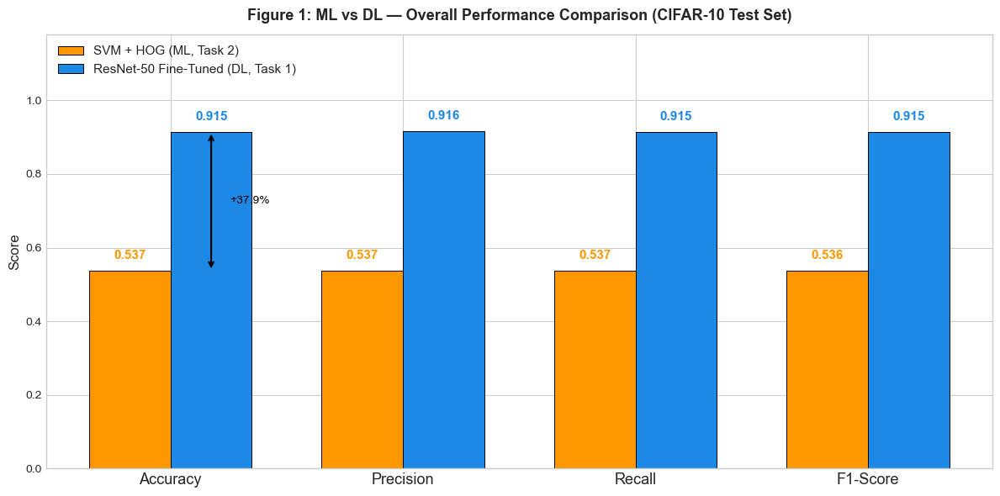
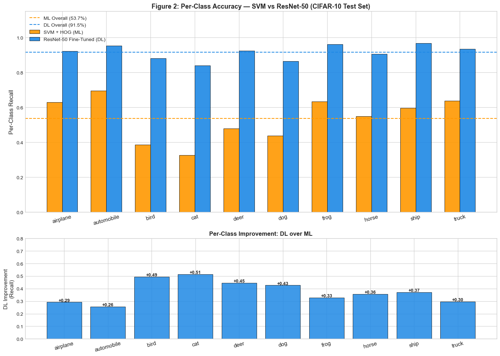
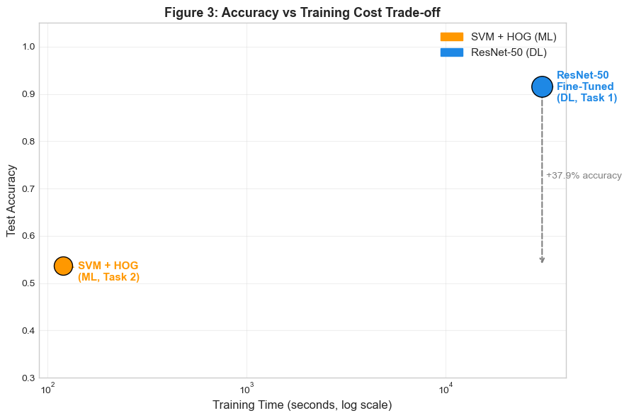
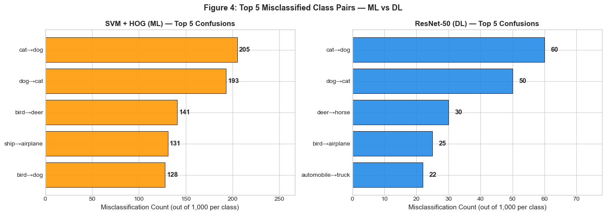

# CIFAR-10: Classical ML vs Deep Learning

How far can hand-crafted features and a tuned SVM go on CIFAR-10, and how much does a fine-tuned pretrained CNN gain over them, on exactly the same data split?



## Results

Both models are evaluated on the official 10,000-image CIFAR-10 test set and trained on the same stratified split (seed 42: 8,000 train / 2,000 validation).

| Model | Test accuracy | F1 (macro) | Training time |
|---|---:|---:|---:|
| SVM (RBF) on HOG features, tuned | 53.7% | 0.537 | 2 min |
| ResNet-50, fine-tuned | **91.5%** | **0.915** | 8.5 h |

Fine-tuning gives a **+37.9 point** gain, at roughly 250x the training cost.

### How each model was chosen

**Classical ML** (`notebooks/01_ml_hog_svm.ipynb`)

| Stage | Result |
|---|---|
| HOG features (1,764 dims) + SVM (RBF) | 53.4% |
| HOG + Random Forest | 44.1% |
| HOG + KNN (k=5) | 41.0% |
| SVM tuned with 5-fold GridSearchCV (C=10, gamma='scale') | **53.7%** |

Tuning barely moves the SVM: the ceiling is the features, not the classifier.

**Deep learning** (`notebooks/02_dl_resnet.ipynb`)

| Stage | Result |
|---|---|
| ResNet-18, frozen ImageNet features + new head | 77.3% |
| EfficientNet-B0, frozen | 79.7% |
| ResNet-50, frozen | 81.3% |
| ResNet-50, last blocks unfrozen and fine-tuned (lr 1e-4, early stopping) | **91.5%** |

### Where the models struggle



Both models find cats, dogs and birds hardest; the SVM loses most on animal classes, where texture and shape vary more than HOG can capture. The full analysis (confused class pairs, accuracy vs cost) is in `notebooks/03_ml_vs_dl_comparison.ipynb`.

| | |
|---|---|
|  |  |

## Takeaways

- Learnt features beat hand-crafted ones by a wide margin on natural images, even with only 8,000 training images, because transfer learning brings ImageNet knowledge with it.
- Unfreezing the last blocks matters: +10 points over using ResNet-50 as a frozen feature extractor.
- When compute or interpretability is the constraint, HOG + SVM still gives a usable baseline in minutes.

## Run it

```bash
pip install -r requirements.txt
jupyter notebook notebooks/
```

CIFAR-10 downloads automatically to `data/` on first run. The SVM grid search takes several hours on a laptop CPU, and fine-tuning ResNet-50 is much faster on a GPU.

## Credits

Built for the COS80027 Machine Learning final project at Swinburne University of Technology, with contributions from **Sushant Shrestha** and **Shrey Patel**.
